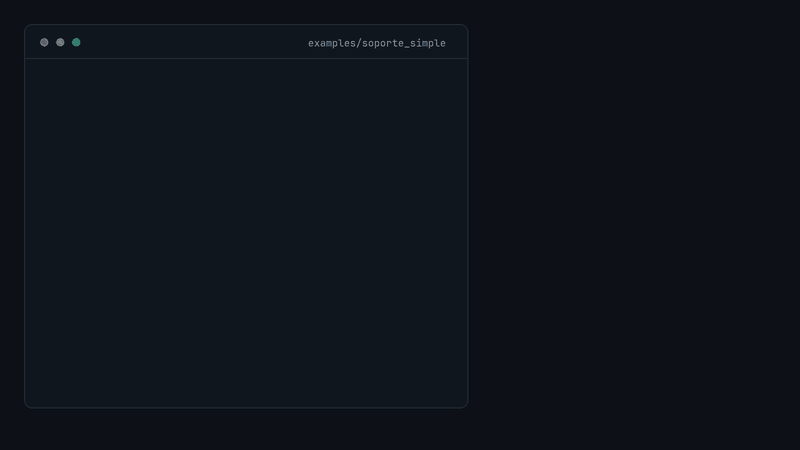
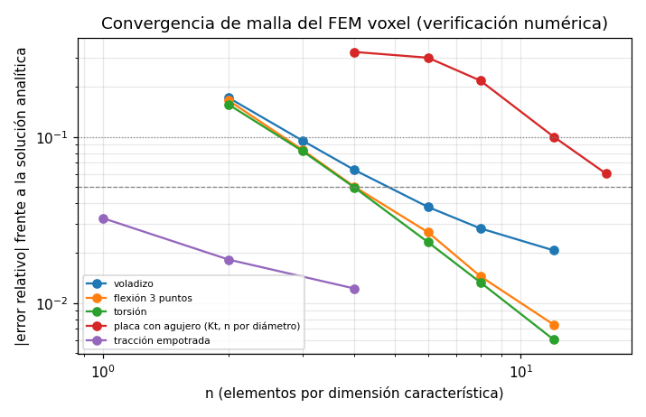

# agentcad

**Una capa de verificación determinista para que agentes de IA organicen, analicen, entiendan y prueben diseños 3D (OpenSCAD/STL) frente a especificaciones, y los optimicen y cambien con código.**

**English:** [README.md](README.md)



> Capa de verificación **determinista y honesta** para agentes de IA que modifican diseños 3D imprimibles. Alpha (0.3.0), MIT. Los nombres de la API (bloques, campos, mensajes) están en español; el README en inglés los glosa.
> Lista honesta de defectos conocidos: [`LIMITACIONES.es.md`](LIMITACIONES.es.md). *Regenerar el GIF:* `python docs/media/demo.py`.

## Por qué

Un agente que modifica un diseño necesita comprobarlo en el bucle, y necesita que la comprobación sea **repetible, barata en tokens y honesta**:

- Las herramientas devuelven **solo valores medidos por código** (JSON estructurado con esquema de entrada y de salida), nunca una estimación del modelo de lenguaje.
- Si no hay un modelo de carga declarado, la respuesta es `no_validado` **sin cifras**; una cifra inventada es peor que ninguna.
- Un resultado es `digital` siempre. Solo un ensayo medido y completo, aportado por una persona, lo marca como `fisico`.
- Los cambios de diseño se componen con **bloques** pequeños y tipados, con puertas que dicen sí/no y rollback por pieza, y todo queda en un diario y en un registro encadenado por hash.

## Qué hay

| Capa | Contenido |
|---|---|
| Herramientas (MCP/CLI/Python) | `describe_part`, `check_interference`, `check_printability`, `evaluate_structure`, `apply_hex_lightening`, `check_spec`, `record_result`, `verify_registro` |
| Spec-as-code | `agentcad/spec_schema.json` (JSON Schema), `check_spec_file`, pruebas derivadas de cada spec (`python -m agentcad.spec_tests`) |
| Bloques | 11 bloques componibles con `MANIFIESTO` tipado y catálogo de una línea por bloque |
| Pipelines | JSON declarativo, dry-run (`validar`), ejecución con diario/checkpoints/reanudación, modo simulado |
| Metodología | SDD, TDD y BDD en español (`docs/SDD.md`, escenarios Gherkin con ejecutor propio), medidor de cobertura propio |

## Instalación

Requiere Python >= 3.12 (probado con 3.14) y estas dependencias, que `pip` instalará: numpy, scipy, trimesh, manifold3d, python-fcl, matplotlib y pillow. OpenSCAD es **opcional**.

```bash
git clone https://github.com/Caelos-Palacio/agentcad && cd agentcad
python -m venv .venv && . .venv/bin/activate
python -m pip install -e .
```

Sin instalar nada (por ejemplo, con un venv que ya tenga las dependencias): `PYTHONPATH=<ruta al repo> python -m agentcad ...`.

## Inicio rápido (con el ejemplo incluido)

`ejemplos/soporte_simple/` es un proyecto autocontenido: una placa de 60x40x3 mm con 4 taladros, pilares y ventanas hexagonales, y un bloque vecino. Los STL se generan con
manifold3d (`generar_stl.py`); no hace falta OpenSCAD. Su `agentcad.toml` declara rutas, perfil de impresión, poses y un modelo de carga.

```bash
cd ejemplos/soporte_simple

agentcad catalogo                                              # lo único que un agente debe leer: una línea por bloque
agentcad ayuda puerta_pared_min                                # contrato completo de un bloque
agentcad bloque puerta_pared_min --entradas '{"pieza":"placa_soporte"}'
# {"ok": true, "pared_min_mm": 1.4736, "veredicto": "cumple", "preexistente": false, "vertical_no_resuelto": false}

agentcad validar revisar_pieza --params '{"pieza":"placa_soporte"}'      # dry-run: esquema, tipos, encaje salidas->entradas
AGENTCAD_PERMITIR_REAL=1 agentcad ejecutar revisar_pieza \
    --params '{"pieza":"placa_soporte"}' --corrida demo --real --primer-plano   # build + puertas + informe
agentcad estado revisar_pieza demo

python -m agentcad.demo_agente                                 # un «agente» (guion sin LLM) aligera la placa usando solo las herramientas MCP
```

Las herramientas también se pueden llamar desde Python:

```python
from agentcad import describe, interference, printability, structure
describe.describe_part('placa_soporte')            # bbox, volumen, masa estimada, agujeros, vecinas...
interference.check_interference('placa_soporte', pose='girado')    # veredicto: 'interfiere' con 13,8 mm3 frente al bloque vecino
printability.check_printability('placa_soporte')   # pared mínima, voladizos, islas, puentes
structure.evaluate_structure('placa_soporte', fidelity=0.8)        # margen según el modelo declarado; 'no_validado' si no lo hay
```

## Configuración del proyecto: `agentcad.toml`

agentcad no conoce tu diseño: lo describes en un archivo `agentcad.toml` en la raíz de tu proyecto (o `AGENTCAD_PROYECTO=<ruta>`). Todo es opcional y tiene un defecto. Ver el del ejemplo,
que está comentado. Secciones: `[rutas]` (carpetas de STL, ensamblaje, specs, registro, trabajo, params), `[bases]` (líneas base: `part = "linea_base:placa"`), `[build]` (comando argv),
`[material]`, `[impresion.<pieza>]` (walls, infill, rot, support, support_regiones, layer), `[poses.<nombre>]`, `[interferencia]` (exentos, categorías excluidas), `[respaldo]`, `[estructura.<pieza>]` (modelo de carga).
Variables de entorno: `AGENTCAD_LOCK` (cola de tareas pesadas; por defecto `~/.cache/agentcad/heavy.lock`), `AGENTCAD_PYTHON`, `AGENTCAD_REGISTRO_DIR`, `AGENTCAD_TRABAJO_DIR`.

El **ensamblaje** (`assembly.json`) es un JSON: `parts: [{id, file, matrix (4x4 en columnas), group, category, printable}]` y `joints: [{id, pivot, axis, groups|parts}]`; las rutas `file` son relativas a la raíz.

## Catálogo de bloques

```
$ agentcad catalogo
# bloque [P pesado, D deshacible, C cacheable] entradas(?=opcional) -> salidas | descripción
aplicar_params [D] config:str pieza:str? -> piezas_activas:arr anteriores:obj | Fija en params.scad los parámetros y el flag de cada pieza elegida (JSON de configuración) y ejecuta sus emisores.
backup [D] etiqueta:str -> ruta:str ya_existia:bool | Copia parámetros, ensamblaje, STL y los archivos de [respaldo] a build/backup_<etiqueta>/ (idempotente).
build [P] - -> ok:bool masa_g:num[g] log:str | Ejecuta el comando [build] de agentcad.toml bajo flock y devuelve la masa estimada del conjunto.
check_gcode [PC] archivo:str perfil:str? guardar:bool? -> ok:bool errores:int avisos:int capas:int islas:int puentes_largos:int voladizos:int soportes_sin_cama:int fuera_de_cama:int caudal_max:num[mm3/s] z_max:num[mm] masa_g:num[g] mensajes:arr detalle:str | Analiza un gcode: islas flotantes, puentes, voladizos, soportes sin cama, límites de cama/Z, temperaturas, caudal, inicio/fin.
estimar_impresion [C] masa_g:num[g] perfil:str? -> filamento_g:num[g] filamento_min_g:num[g] filamento_max_g:num[g] tiempo_h:num[h] tiempo_min_h:num[h] tiempo_max_h:num[h] fiable:bool nota:str | Estima filamento y tiempo de impresión desde la masa del CAD con una calibración declarada y su error; sin calibración no da cifras.
informe [-] etiqueta:str diario:str filas:arr? extra:arr? -> ruta:str incumplimientos:int revertidas:arr | Escribe build/INFORME_<etiqueta>.md desde el diario del pipeline: pasos, puertas por pieza, rollbacks, incumplimientos conocidos y digital vs físico.
puerta_imprimibilidad [PC] pieza:str base:str? -> ok:bool nuevos_fallos:arr estado:str | Puerta: la pieza no incumple ningún criterio de imprimibilidad que la línea base sí cumpla (pared, voladizos, islas, puentes).
puerta_interferencia [PC] pieza:str pose:str? conocido_mm3:num[mm3]? -> ok:bool volumen_mm3:num[mm3] estado:str | Puerta: la pieza no interfiere (> 0,1 mm3) con sus vecinas, salvo el volumen conocido declarado (agentcad.check_interference).
puerta_margen_fem [C] config:str pieza:str -> ok:bool base:num[adimensional] candidato:num[adimensional] incumple_criterio:bool estado:str nota:str | Puerta: el margen FEM de la pieza no es peor que el de la línea base a igual malla; marca el incumplimiento conocido si queda bajo el criterio.
puerta_masa [-] base_g:num[g] tolerancia_g:num[g]? -> ok:bool masa_g:num[g] delta_g:num[g] | Puerta: la masa estimada del conjunto no supera la de la revisión base (+ tolerancia).
puerta_pared_min [PC] pieza:str umbral_mm:num[mm]? base:str? -> ok:bool pared_min_mm:num[mm] veredicto:str preexistente:bool vertical_no_resuelto:bool | Puerta: pared mínima imprimible >= umbral, o no peor que la línea base si esta ya incumplía (check_printability).
```

El catálogo completo ocupa unos 2,8 kB (alrededor de 800 tokens por estimación de 3,5 caracteres/token; era 2,0 kB y ~585 con 9 bloques; una prueba vigila que no pase de 2.500). `[mm]`, `[g]`... son las **unidades** de cada campo numérico y `C` marca los bloques **cacheables** (deterministas). Las **puertas** devuelven siempre `ok`; un bloque `pesado` toma solo la cola `flock` compartida;
las salidas son pequeñas (máx. 4 KB: rutas + cifras) y los datos pesados viajan por referencia.

## Componer un pipeline

Un pipeline es un JSON (`agentcad/pipeline_schema.json`). La lista de pasos es una ordenación topológica del DAG: `$paso.salida` solo apunta hacia atrás. Ejemplo mínimo:

```json
{"esquema": "agentcad.pipeline/1", "nombre": "mini", "descripcion": "revisa una pieza",
 "parametros": {"pieza": {"type": "string"}},
 "pasos": [
  {"id": "construir", "bloque": "build", "en_fallo": "reintentar"},
  {"id": "pared", "bloque": "puerta_pared_min", "entradas": {"pieza": "$pieza"}},
  {"id": "interf", "bloque": "puerta_interferencia", "entradas": {"pieza": "$pieza"},
   "si": {"no": "$_revertidas"}}]}
```

Reglas: `si` (referencia o `{no|y|o|igual|menor}`), `para_cada` + `como`, `en_fallo`: `abortar` (defecto) | `saltar` | `reintentar` | `{accion: reintentar, max}` |
`{accion: rollback, paso, entradas, repetir_desde, max}` (deshace el paso con el `deshacer` del bloque y repite desde `repetir_desde`). `agentcad validar` hace un dry-run completo
(esquema, bloques existentes, tipos de literales y referencias, encaje salidas->entradas, rollback coherente) **antes** de ejecutar nada. Pipelines incluidos: `ejemplos/soporte_simple/pipelines/revisar_pieza.json`
y `agentcad/pipelines/integrar_variante.json` (aplica variantes por pieza, reconstruye, pasa puertas por pieza con rollback y escribe el informe).

Diario y checkpoints en `<raiz>/build/pipelines/<pipeline>.<corrida>.json`; `agentcad reanudar` continúa desde el último paso correcto. **Modo simulado** (`--simulado`, `agentcad copia_simulada <dir>`):
los bloques pesados leen un modelo sintético `sim.json` para ensayar la lógica de puertas y rollback sin geometría; el informe lo declara y ninguna cifra simulada prueba nada.
El **modo real** exige `AGENTCAD_PERMITIR_REAL=1` y la raíz real del proyecto.

## Caché, unidades y procedencia

- **Caché por hash de entradas.** Un bloque con `determinista=True` guarda su resultado en `<raiz>/build/cache/<bloque>/<clave>.json`. La clave es el sha256 del bloque (su código y manifiesto), sus entradas, el modo
  (real/simulado) y una *huella de datos* (los STL, el ensamblaje y `agentcad.toml`). Si algo cambia, se recalcula; si no, el paso del diario marca `cache: "acierto"`. Se cachean también los `ok: false`
  (igual de deterministas); una excepción nunca. `AGENTCAD_SIN_CACHE=1` la desactiva. Idea tomada de Snakemake/DVC, implementación propia (`agentcad/cache.py`).
- **Unidades tipadas.** Los campos numéricos de los bloques y los parámetros de pipelines pueden llevar `unidad` (`mm`, `mm3`, `g`, `kg`, `MPa`, `N`, `grados`, `adimensional`...). El dry-run
  (`agentcad validar`) rechaza conectar una salida con otra magnitud (`mm` -> `g`) y también una unidad distinta de la misma magnitud (`m` -> `mm`: hay que convertir explícitamente; `agentcad.unidades.convertir`).
  Un campo sin unidad no se comprueba. No hay conversión implícita.
- **Procedencia.** Cada salida de herramienta lleva `procedencia` (versión de agentcad y librerías, sha256 del STL, de la spec y de `agentcad.toml`, solver con el hash de su código, commit git del proyecto y de agentcad
  si existen); también cada línea del registro encadenado por hash (manipularla rompe la cadena) y cada paso del diario de pipelines (sha256 del bloque y de las entradas). `agentcad/procedencia.py`.

## Añadir un bloque (TDD)

```bash
agentcad nuevo_bloque mi_bloque     # crea agentcad/bloques/mi_bloque.py (borrador) y tests/bloques/test_mi_bloque.py (prueba de contrato en ROJO)
```

Un bloque es un módulo con `MANIFIESTO` (valida contra `bloque_schema.json`: nombre, descripción de una línea, entradas/salidas tipadas, precondiciones, efectos, `pesado`, `deshacible`, `honestidad`),
`ejecutar(entradas, ctx)` y, opcionalmente, `simular` (obligatorio si es pesado) y `deshacer`. Un bloque sin prueba de contrato no se registra y un borrador no se puede usar en un pipeline. El campo
`honestidad` es obligatorio: cada bloque declara qué es digital y qué requiere prueba física.

## Cómo se integra

agentcad es una **capa** que se coloca sobre lo que ya uses; no sustituye a ningún orquestador ni a ningún solver. Se integra por estas vías, todas incluidas:

1. **Servidor MCP por stdio** (JSON-RPC 2.0, un mensaje JSON por línea, sin dependencias externas): `python -m agentcad.server` (o `agentcad-mcp`) desde la raíz del proyecto.
   Para registrarlo en un cliente MCP (por ejemplo Claude Code): `claude mcp add agentcad -- python -m agentcad.server` con el directorio de trabajo en tu proyecto.
2. **CLI** (`agentcad ...` o `python -m agentcad ...`): `catalogo`, `ayuda`, `validar`, `ejecutar` (alias `correr`), `reanudar`, `estado`, `bloque`, `nuevo_bloque`, `copia_simulada`. Salida de texto/JSON, códigos de salida 0/1,
   así que cualquier orquestador capaz de lanzar un comando (Snakemake, Airflow, Make, CI, un script) puede ejecutar un bloque o un pipeline como un paso más.
3. **API de Python**: las funciones de `agentcad.describe`, `interference`, `printability`, `structure`, `lightening`, `spec`, `registro` y `pipeline.ejecutar_bloque` devuelven diccionarios JSON-serializables.

4. **Adaptadores finos** en [`integraciones/`](integraciones/README.md) para ejecutar un bloque o pipeline como regla de **Snakemake**, nodo de **LangGraph** o tarea de **Airflow**. **No están probados con la librería real**
   (no están instaladas aquí): solo con dobles que verifican la lógica del adaptador (entradas, JSON de salida, fallo por puerta en rojo, reanudación).

## Caso de éxito

Extraído de un brazo robótico impreso en 3D: el flujo de agentes bajó el conjunto de 490,1 g (rev. 3.7) a 463,7 g (rev. 3.8), cazó un nervio de 0,67 mm que el FEM de 1 mm no veía y **rechazó** `turret_c` porque su margen bajaba (2,03 a 1,97).
`base_flange` 76,8 a 57,0 g con margen 0,34 a 0,68 (sigue incumpliendo >= 2, declarado). Todo digital: falta imprimir, pesar y ensayar. Detalle y límites en [`docs/caso_brazo_robotico.md`](docs/caso_brazo_robotico.md).

## Laminado: `check_gcode`, comparación con el laminador y calibración

- **`check_gcode`** (bloque, núcleo en `agentcad/gcode.py`): analiza un gcode ya laminado (Orca/Prusa-like, comentarios `;TYPE:`) capa a capa y por objeto: islas flotantes, puentes largos, voladizos, soportes que no parten de la cama, límites de cama y Z, temperaturas,
  velocidad, caudal volumétrico, inicio/fin y filamento. Cama, altura y límites se declaran en `[gcode.perfiles.<nombre>]` de `agentcad.toml`; el ejemplo trae un gcode diminuto **sintético**
  (`python generar_gcode.py`, ignorado por git) y el pipeline `revisar_laminado`. No hay modo físico: `deshacer` no aplica (solo lee) y el modo simulado devuelve cifras sintéticas.
- **`estimar_impresion`** (bloque): filamento y tiempo desde la masa del CAD con una **razón y un error declarados** en `[calibracion]` (se ajustan con `agentcad.calibracion.calibrar`). Sin calibración no da cifras; con menos de 8 grupos avisa `fiable: false`.
- **Datos y honestidad** en [`validacion/laminador/INFORME.md`](validacion/laminador/INFORME.md): 16 piezas de 4 placas del brazo, laminadas con Anycubic Slicer Next para 3 impresoras (los gcodes, 463 MB, no se publican; solo tablas pequeñas). `check_printability`
  frente al rebanado de la STL sin soportes (A) y frente al gcode con soportes del laminador (B), sobre 16 piezas:

| categoría | verdad | TP | FP | FN | TN |
|---|---|--:|--:|--:|--:|
| islas | A | 4 | 1 | 0 | 11 |
| islas | B | 0 | 5 | 0 | 11 |
| puentes largos | A | 4 | 0 | 1 | 11 |
| puentes largos | B | 3 | 1 | 1 | 11 |
| voladizos | A | 6 | 0 | 2 | 8 |
| voladizos | B | 4 | 2 | 3 | 7 |

  Son cifras de un solo caso con pocos positivos. Frente a B, las islas «FP» son las que el laminador cubre con soporte; los FN de voladizos son voladizos locales en piezas grandes que el umbral del 2 % del área total no ve. Masa: el estimador del CAD da 468 g y el laminador 393 a 405 g
  (con soportes), 12 % por debajo de los 449,8 g citados; tiempos de 17 h 55 min a 25 h 15 min por juego. Un modelo de una razón por impresora tiene error de validación cruzada del 7 al 8 % medio (máx. 10 % en filamento, 16 a 18 % en tiempo) con **solo 4 placas**: indicativo, no fiable. Todo digital.

## Verificación numérica del solver

El FEM voxel se **verificó numéricamente contra soluciones analíticas** (no hay validación física con ensayos). Suite en [`validacion/`](validacion/README.md), tablas completas en [`validacion/TABLAS.md`](validacion/TABLAS.md):

| caso (referencia) | n = 2 | n = 4 | n = 8 | n = 12 |
|---|---|---|---|---|
| voladizo (Timoshenko) | -17,2 % | -6,3 % | -2,8 % | -2,1 % |
| flexión en tres puntos, flecha (Timoshenko) | -16,6 % | -5,0 % | -1,5 % | -0,7 % |
| torsión (Saint-Venant) | -15,7 % | -5,0 % | -1,3 % | -0,6 % |
| barra a tracción, ideal / empotrada | 0 / -1,8 % | 0 / -1,2 % | | |
| placa con agujero, Kt (Peterson; n por diámetro) | | -32,5 % | -21,9 % | -10,0 % (n=16: -6,0 %) |
| placa apoyada, a/h = 10 (Kirchhoff; n = 2 y 4) | -7,7 % | +6,0 % | | |



Negativo = el FEM es más rígido que la teoría (o subestima el pico): lado inseguro. El orden observado de la flecha es ~1,6 a 1,8 (hexaedro lineal, bloqueo por cortante); el pico de tensión en el agujero no entra en régimen
asintótico hasta n > 16. **Resolución mínima recomendada** (n elementos por canto menor, error medido <= 5 %): vigas a flexión 6, torsión 4, tracción 1; placas a flexión 2 (<= 10 %; 5 % no alcanzado); pico de tensión en agujeros 16 por
diámetro (<= 10 %). `evaluate_structure` usa esa tabla: devuelve `fidelity.error_medido` y avisa si el error medido a la resolución elegida supera el 5 %. Es el error de estas geometrías, no una garantía para otras piezas.

## Qué esperar (honestidad digital / físico)

- Todo resultado lleva `nivel_validacion: "digital"` y una lista de `limites`. Lo que se mide por código y lo que habría que medir en el banco se mantienen separados en cada salida.
- `evaluate_structure` solo da margen si declaras un modelo de carga; cualquier otra pieza devuelve `no_validado`. El solver se ha **verificado numéricamente** contra soluciones analíticas
  (viga, placa) y es más rígido que la teoría en malla gruesa; **no está validado físicamente con ensayos** (ver `LIMITACIONES.es.md`).
- La lista completa de defectos conocidos del núcleo, con su alcance, está en [`LIMITACIONES.es.md`](LIMITACIONES.es.md). Léela antes de usar un veredicto para decidir algo.

## Pruebas

```bash
python -m unittest discover -s tests -t .                     # suite completa (unas 610 pruebas, ~3 min)
AGENTCAD_RAPIDAS=1 python -m unittest discover -s tests -t .  # sin las pesadas (FEM, voxelización fina, procesos con límites, aligerado)
python -m agentcad.bdd_runner tests/features/pipelines --pasos tests/features/pipelines/pasos_pipeline.py   # escenarios Gherkin en español
python -m agentcad.cobertura --excluir 'tests/*' -- discover -s tests -t .      # cobertura de líneas con sys.monitoring (sin dependencias)
```

No hace falta pytest ni coverage. Las pruebas trabajan sobre el ejemplo o sobre copias temporales y no escriben en el repositorio. Historial y metodología: `docs/SDD.md`.

## Hoja de ruta

- Verificación cruzada opcional con CalculiX (propuesta con coste/beneficio en `validacion/README.md`).
- Probar los adaptadores de `integraciones/` con Snakemake, LangGraph y Airflow reales; un caso de éxito documentado.

## Licencia

MIT. Copyright (c) 2026 Caelos-Palacio.
